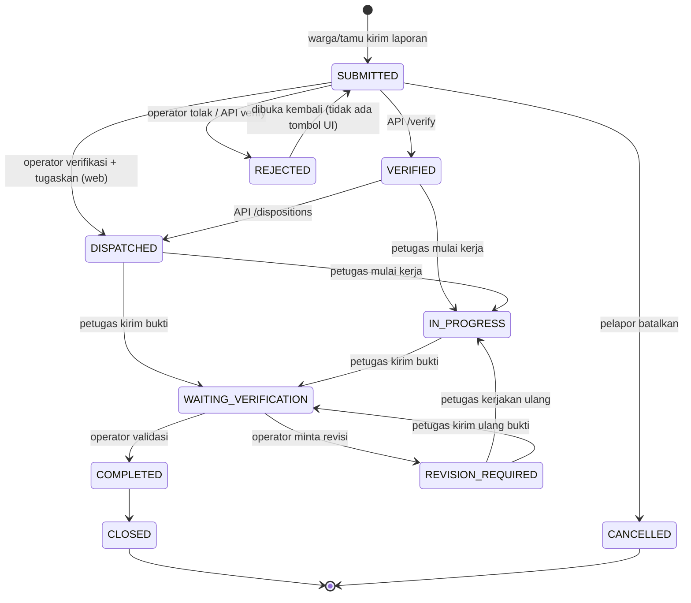
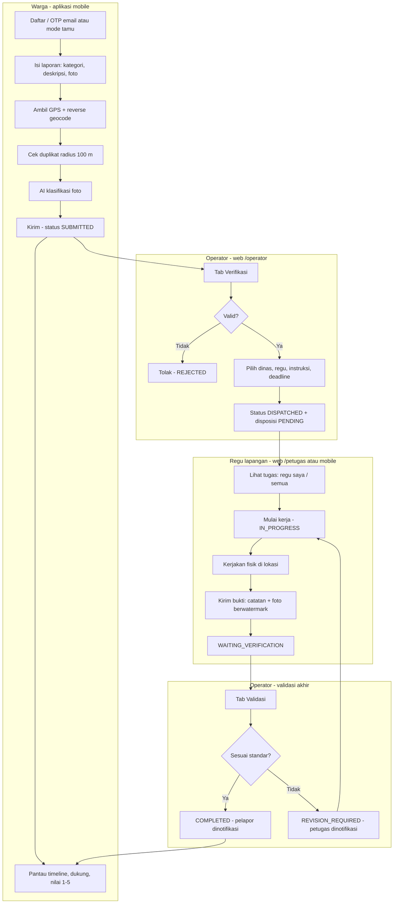

# Alur Workflow SI-APPIK

Sistem Informasi Pengaduan & Penanganan Kerusakan Infrastruktur Kabupaten Kolaka Utara.
Dokumen ini memetakan alur yang **benar-benar berjalan di kode**, bukan hanya yang tertulis di aturan.

Terakhir diverifikasi: server lokal `127.0.0.1:8000`, PostgreSQL `sik` (12 aduan, 19 user).

---

## 1. Peran dan portal

| Peran | Portal | Bisa apa |
| :--- | :--- | :--- |
| WARGA / TAMU | Aplikasi mobile saja | Lapor, lacak, dukung, nilai, chatbot. **Ditolak login di web** (`WebAuthController.php:57`). |
| PETUGAS | Web `/petugas` + mobile | Ambil tugas, mulai kerja, unggah bukti selesai, revisi. |
| OPERATOR | Web `/operator` | Verifikasi, penugasan regu, tolak, validasi akhir, arsip. |
| SUPERADMIN / ADMIN | Web `/admin` | Pengguna, regu, wilayah GIS, mode penugasan, tolak permanen, laporan. |
| KEPALA DAERAH / BUPATI | Web `/bupati` | Hanya baca: ringkasan, peta, kinerja, ekspor/cetak. |

Tanpa login semua rute staf mengembalikan `302 -> /login` (terverifikasi).

---

## 2. Siklus status resmi

Catatan penting:

- Jalur utama web operator adalah **SUBMITTED -> DISPATCHED** (satu langkah). Status `VERIFIED` praktis hanya dipakai lewat API.
- `DISPATCHED -> WAITING_VERIFICATION` diizinkan, sehingga petugas bisa menyelesaikan tugas tanpa pernah berstatus `IN_PROGRESS`.
- `CANCELLED` tidak tercantum di AGENTS.md tetapi dipakai kode.
- Super Admin menolak permanen tanpa lewat state machine: status apa pun selain `REJECTED`/`CANCELLED`/`CLOSED` -> `REJECTED` dengan `rejected_by_superadmin = true`, lalu disembunyikan dari semua query publik oleh global scope (`Complaint.php:64`).
- Merge duplikat juga menembus state machine: laporan anak langsung `CLOSED` dengan `parent_complaint_id` (`WorkflowController::merge`).

---

## 3. Alur end-to-end

---

## 4. Rincian tiap tahap

### 4.1 Pelaporan (warga)

| Langkah | Endpoint | Aturan yang berjalan |
| :--- | :--- | :--- |
| Registrasi | `POST /api/v1/auth/register/send-otp`, `POST /auth/register` | OTP 6 digit, berlaku 10 menit, hangus setelah 3 salah, throttle 5/menit |
| Login | `POST /auth/login`, `POST /auth/google` | Token Sanctum; akun nonaktif ditolak |
| Cek telepon | `GET /auth/check-phone` | Mencegah nomor ganda |
| Kirim laporan | `POST /complaints` | Throttle 10/menit; boleh anonim (akun bersama `tamu@kabupaten.go.id`) |
| Geofence | di dalam `store` | lat `-3.80..-2.75`, lon `120.70..121.50` (`ComplaintController.php:317`) |
| Ruas panjang | `damage_type=major` | Kategori dipaksa 1 (Jalan), minimal 5 foto, simpan titik akhir + `route_coordinates` |
| Duplikat | `GET /complaints/nearby-duplicates` | Radius 100 m; PostGIS bila tersedia, Haversine bila tidak |
| AI | `POST /ai/classify-image` (throttle 15/menit) | Mengisi `ai_category`, `ai_confidence`; gagal -> status belum terverifikasi |
| Kode tiket | otomatis | `0001/ringan/2026` atau `0001/berat/2026` |
| Prioritas | saat simpan | severity 35%, dukungan 20%, lokasi 20%, umur 15%, duplikat 10% -> LOW/MEDIUM/HIGH/CRITICAL |
| Batal | `POST /complaints/{id}/cancel` | Hanya pelapor, hanya sebelum diproses |
| Dukung | `POST/DELETE /complaints/{id}/supports` | Hanya role WARGA, tidak untuk laporan selesai/ditolak |
| Nilai | `POST /complaints/{id}/rating` | Hanya pelapor asli, hanya status COMPLETED/CLOSED |

### 4.2 Verifikasi dan penugasan (operator web)

`POST /operator/complaints/{id}/verify-dispatch` (`WebOperatorController.php:222`)

1. Hanya dari `SUBMITTED`, `VERIFICATION`, atau `VERIFIED`; status lain ditolak dengan pesan ramah.
2. Wajib `department_id` dan `instruction`; `team_id` wajib bila mode `OPERATOR_ONLY`.
3. Deadline dari `deadline_date` atau `deadline_days` (1..30, default 3 hari).
4. Efek: status -> `DISPATCHED`, satu baris `dispositions` (`PENDING`, `assigned_to` = ketua regu bila regu dipilih).
5. Notifikasi: semua anggota regu; bila tanpa regu dan tanpa petugas -> semua PETUGAS ditawari klaim; pelapor selalu dinotifikasi.

Aksi lain di tab yang sama:

- `POST /operator/complaints/{id}/assign-team` — ubah/lepas regu selama `DISPATCHED`/`VERIFIED`; diblokir pada mode `SELF_CLAIM_ONLY`.
- `POST /operator/complaints/{id}/reject` — alasan wajib, status -> `REJECTED`.

### 4.3 Pengerjaan lapangan (petugas)

`POST /complaints/{id}/start-work` (`WorkflowController.php:213`, web `WebPetugasController.php:251`)

1. Hanya dari `VERIFIED`, `DISPATCHED`, `REVISION_REQUIRED`.
2. Mode `OPERATOR_ONLY`: harus sudah ditunjuk dan regu harus cocok, kalau tidak `403`.
3. Mode `HYBRID`/`SELF_CLAIM_ONLY`: tugas yang sudah dipegang regu lain tidak boleh diambil (`403`).
4. Efek: status -> `IN_PROGRESS`, disposisi diisi `assigned_to`/`team_id` bila kosong, pelapor dinotifikasi.

`POST /complaints/{id}/finish-work` (`WorkflowController.php:291`)

1. Wajib `note`; foto opsional (maks 10 MB per file).
2. Team shield: di API hanya `SUPERADMIN`/`ADMIN`/`OPERATOR` yang boleh menembus; di web hanya `SUPERADMIN`.
3. Foto disimpan dua kali: file di `storage/app/public/resolutions` (watermark kode tiket + koordinat + nama petugas) dan base64 di `complaint_photos.file_data`.
4. Efek: status -> `WAITING_VERIFICATION`, disposisi -> `WAITING_VERIFICATION`, pelapor dinotifikasi.

Mobile punya antrean offline (`OfflineResolutionQueueService`) agar bukti tetap terkirim saat sinyal buruk.

### 4.4 Validasi akhir (operator)

`POST /operator/complaints/{id}/validate` (`WebOperatorController.php:398`), keputusan `COMPLETED` atau `REVISION_REQUIRED`.

- `COMPLETED`: disposisi selesai, pelapor dinotifikasi "Selesai".
- `REVISION_REQUIRED`: disposisi revisi, petugas yang ditugaskan dinotifikasi, tugas kembali masuk antrean kerja.

### 4.5 Administrasi (super admin)

- Pengguna: buat, ubah, reset sandi, nonaktifkan/aktifkan (dengan alasan). Akun baru wajib aktivasi first-login: nama, no. HP, sandi baru yang tidak boleh "password" (`WebAuthController.php:213`).
- Regu: buat/ubah/hapus, tambah/lepas anggota, set ketua, set `dispatch_mode`.
- Wilayah: tambah/hapus region, ubah koordinat poligon.
- Tolak permanen: wajib mengetik ulang `#kode/tiket` sebagai konfirmasi; masuk arsip khusus Super Admin.
- Akun Bupati: ubah data akun kepala daerah.

### 4.6 Eksekutif (bupati)

Murni baca: ringkasan status, peta maksimal 150 titik, semua laporan + arsip, kinerja per dinas, statistik per kecamatan/desa, tombol ekspor CSV dan cetak BAP/kinerja. Tidak ada aksi yang mengubah data.

### 4.7 Publik (landing)

Statistik status + kategori (cache 60 detik), peta Leaflet, daftar laporan tanpa `REJECTED`/`DRAFT`/`CANCELLED`, telepon disensor, pencarian kode tiket, modal detail. Tidak ada formulir pelaporan di web.

---

## 5. Alur pendukung

| Alur | Titik masuk | Perilaku |
| :--- | :--- | :--- |
| Lupa sandi | `POST /auth/forgot-password/send-otp` lalu `/forgot-password` | OTP email; WARGA hanya lewat mobile |
| Ganti sandi | `POST /auth/change-password` | Wajib sandi lama; email peringatan keamanan |
| Notifikasi | `GET /notifications` | Hanya baris DB milik user; tidak ada push/FCM |
| Chatbot | `POST /chat/sessions`, `POST /chat/sessions/{id}/messages` | Mesin aturan: FAQ, cek kode tiket, susun draf laporan |
| Ekspor CSV | `GET /reports/export-csv` | Operator/Super Admin/Dinas/Bupati |
| Cetak BAP | `GET /complaints/{id}/bap` | Format berita acara penyelesaian |
| Cetak kinerja | `GET /petugas/performance/print` | Rekap per petugas/regu |
| Cetak dari mobile | `/mobile-print/...` | Signed URL 30 menit |

Mode penugasan (`system_settings.dispatch_mode`):

| Mode | Arti |
| :--- | :--- |
| `OPERATOR_ONLY` | Regu wajib ditunjuk operator; petugas tidak bisa klaim bebas |
| `HYBRID` (default) | Operator menugaskan, tugas tanpa regu boleh diklaim regu mana pun |
| `SELF_CLAIM_ONLY` | Operator tidak boleh menugaskan; regu mengklaim sendiri |

---

## 6. Wewenang transisi

| Dari | Ke | Aktor | Jalur |
| :--- | :--- | :--- | :--- |
| SUBMITTED | DISPATCHED | OPERATOR | web `verify-dispatch` |
| SUBMITTED | VERIFIED / REJECTED | OPERATOR | API `/verify` |
| SUBMITTED | CANCELLED | pelapor | API `/cancel` |
| VERIFIED | DISPATCHED | OPERATOR | API `/dispositions` |
| VERIFIED / DISPATCHED / REVISION_REQUIRED | IN_PROGRESS | PETUGAS | `start-work` (web + API) |
| DISPATCHED / IN_PROGRESS | WAITING_VERIFICATION | PETUGAS | `finish-work` (web + API) |
| WAITING_VERIFICATION | COMPLETED / REVISION_REQUIRED | OPERATOR | web `validate`, API `validate-resolution` |
| semua kecuali REJECTED/CANCELLED/CLOSED | REJECTED (permanen) | SUPERADMIN | web `admin/complaints/{id}/reject` |
| apa pun | CLOSED (merge) | OPERATOR/SUPERADMIN | API `/merge` |

---

## 7. Status aturan (setelah perbaikan)

Sudah ditegakkan di kode dan diuji:

1. **Kuota tugas aktif maksimal 3 per regu** — `FieldTaskAuthorizer::assertCanStart`, dipakai bersama web dan API. Batas dapat diubah lewat `system_settings.max_active_tasks`.
2. **Team shield seragam** — regu lain selalu `403` di web maupun API; hanya `SUPERADMIN`/`ADMIN` yang boleh menembus. Otorisasi diperiksa sebelum transisi status agar `403` menang atas `422`.
3. **Transisi status ilegal mengembalikan 422**, bukan 500 (`InvalidStatusTransitionException` + handler di `bootstrap/app.php`).
4. **Jejak audit benar** — pembatalan pelapor dan penolakan Super Admin kini mengisi `actor_id`/`changed_by`; merge mencatat `from_status` yang sebenarnya.
5. **Uji otomatis** — `WorkflowAuthorizationTest` mengunci ketiga aturan di atas (18 test, 81 assertion, semuanya lulus).

Belum diselesaikan (keputusan produk, bukan bug kritis):

1. Hasil AI per laporan tidak disimpan; klasifikasi hanya dikembalikan ke klien lewat `/ai/classify-image`.
2. Akun baru dari Super Admin memakai sandi awal `password`; modal first-login masih imbauan, belum memblokir.
3. `COMPLETED -> CLOSED` belum punya aksi di UI.
4. Orkestrasi alur masih ditulis di dua tempat (API dan web) meski aturannya kini satu service.
5. Lompatan `SUBMITTED -> DISPATCHED` dan `DISPATCHED -> WAITING_VERIFICATION` masih diizinkan karena mengikuti alur web saat ini.

---

## 8. Peta berkas

| Kebutuhan | Berkas |
| :--- | :--- |
| State machine | `backend/app/Domain/Complaints/Services/ComplaintStateMachine.php` |
| Alur API | `backend/app/Http/Controllers/Api/v1/WorkflowController.php` |
| Alur web operator | `backend/app/Http/Controllers/Web/WebOperatorController.php` |
| Alur web petugas | `backend/app/Http/Controllers/Web/WebPetugasController.php` |
| Administrasi | `backend/app/Http/Controllers/Web/WebSuperAdminController.php`, `WebTeamController.php` |
| Eksekutif | `backend/app/Http/Controllers/Web/WebBupatiController.php` |
| Laporan | `backend/app/Http/Controllers/Api/v1/ComplaintController.php` (store, rating, support) |
| Duplikat | `backend/app/Domain/Complaints/Services/DuplicateDetectionService.php` |
| Prioritas | `backend/app/Domain/Complaints/Services/PriorityService.php` |
| AI | `backend/app/Domain/AI/Services/AICVService.php`, `Scripts/ai_analyzer.py` |
| Chatbot | `backend/app/Domain/Chatbot/Services/ChatbotService.php` |
| Notifikasi | `backend/app/Models/Notification.php`, `Api/v1/NotificationController.php` |
| Mobile warga | `mobile/lib/features/complaints/presentation/create_complaint_screen.dart` |
| Mobile petugas | `mobile/lib/features/field/presentation/field_tasks_screen.dart` |
